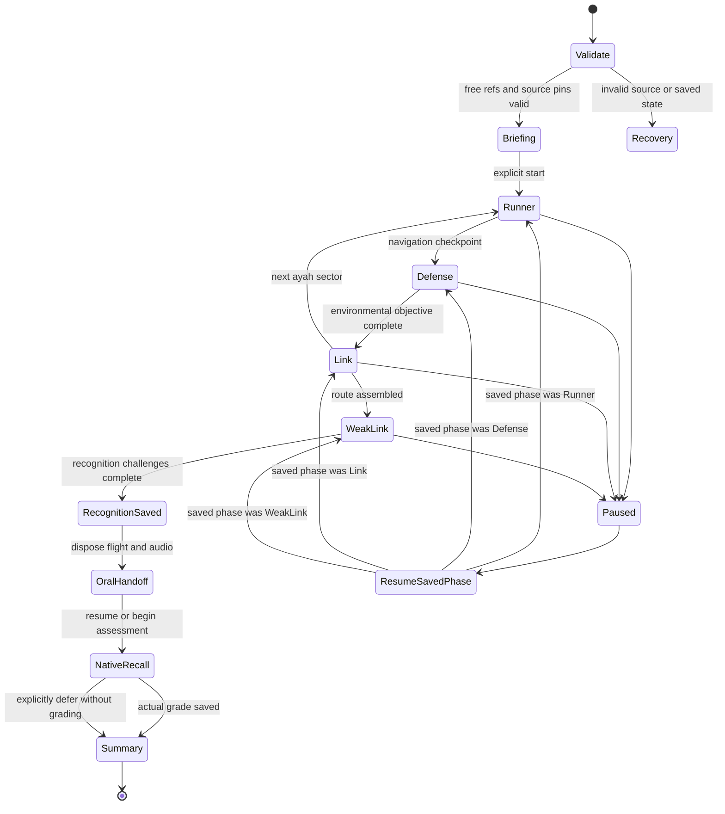

# Cosmic Rush — Ayah Relay 2.0 specification

Phase 6 implementation: [Weak-Link Bosses and saved expeditions](cosmic-rush-expeditions.md) coordinates the available activities, adds evidence-backed celestial shields and offers native self-assessed passage recall. Historical inventories below remain audit snapshots.

Phase 5 implementation: [Ayah Link and Phrase Repair](cosmic-rush-ayah-link.md) adds adjacent-ayah demonstrations, steerable gateways, reviewed visual reactors and source-backed weak-link evidence. Historical inventories below remain audit snapshots.

Phase 4 implementation: [Meteor Defense](cosmic-rush-meteor-defense.md) adds playable core defense and checkpoint handovers through the shared mission director. Historical audit inventories below remain unchanged.

Current public flight: [flowing Quran pickups](cosmic-rush-flowing-pickups.md) supersede navigation stars; untimed gateway review is optional at stage checkpoints. Earlier phase descriptions below are historical snapshots.
## Status and scope

Subsequent implementation: [Phase 3 Quran memory gateways](cosmic-rush-gateways.md). The inventory and baseline below remain the Phase 0 audit snapshot, not a claim that later phases were implemented by that audit.

Phase 0 audit refresh: **2026-11-03 (America/Chicago)**. Audited base commit: `99787f0`, plus the existing, uncommitted Phase 1 mission planner and Phase 2 Star Runner working-tree changes. A commit ID alone does not reproduce this baseline; the current working tree is part of the audit. Existing source changes and saved records were preserved.

**This audit changes documentation only. It adds no gameplay, navigation, migration, dependency or learning-policy behavior.** Existing gameplay described below was already present before this audit. Architecture labeled proposed remains future work.

Related implementation notes: [Phase 1 mission planning](cosmic-rush-phase1.md) and [existing Star Runner](cosmic-rush-star-runner.md). Their historical test results are separate from the fresh baseline in section 10.

The complete Cosmic Rush hybrid experience is still proposed, building on the existing Revision Lab and Star Runner: Star Runner → Meteor Defense → Ayah Link → Weak-Link Boss → Final Oral Recall. It must involve genuine movement and environmental interaction, not five themed multiple-choice screens.

**Content policy is permanently free-only for this feature:** Al-Fatihah (1) and Juz Amma (78–114). The current local library contains 38 surahs and 571 ayahs (7 + 564). Subscription, reviewer, and developer privileges must not expand a Cosmic Rush mission's scope. No premium content needs to be downloaded to play.

## 1. Current repository architecture

| Area | Existing implementation and implications |
| --- | --- |
| Application | Vanilla ES modules, Vite, Supabase JS and `ts-fsrs` 5.4.2. `src/main.js` owns the principal render/state loop. No installed game engine or native mobile wrapper was found. |
| Navigation | Your Space exposes Memorization Lab, Puzzle Lab, **Revision Lab**, daily quests and progress. `src/revision/ui.js` mounts the public Cosmic planner through the existing main navigation. Memorization has Practice, Puzzle Quest, puzzle Active Recall and Ayah Chain; the independent self-assessment is a distinct review flow. The collapsible menu is managed by `src/ui/site-menu.js`. |
| Developer surfaces | `src/billing/ui.js` currently places Passage Builder, passage studio, Expedition, Rescue, Repair, Boss Rush, Survival and other advanced entries behind developer menu visibility. Visibility is separate from server content authorization. Do not expose this entire menu to create a public free game entry. |
| Relay / Cosmic Rush | `src/quest/cosmic/mission.js` and `controller.js`, `src/revision/`, and `src/puzzles/arcade/cosmic/` already implement public mission configuration and the motor-only Star Runner phase. No separate legacy Ayah Relay engine or complete hybrid campaign was found. `src/sequence.js` is the existing Ayah Chain, not a flight relay. |
| Arcade registry | `src/puzzles/arcade/registry.js` registers available `asteroids` (Ayah Space), `sirat` (Sirat Quest), `maze` (Memory Maze), `bubble` (Ayah Bubble Burst), `snake` (Ayah Serpent), and `bridge` (Bridge Builder). Ayah Blocks (`falling`) and a developer example also exist. The six requested arcade engines are implemented, not merely planned. |
| Legacy games | Vanishing Ayah, Jigsaw, Memory Match, Broken Chain, Continue the Ayah and Similar Ayah Detective remain preserved as developer-only activities. Their saved data must survive. |
| Arcade lifecycle | Registry/launcher instances expose `start`, `pause`, `resume`, `dispatch`, `getSnapshot`, `dispose`. Shared session logic separates three memory strikes from motor errors and assistance. Classic retains strikes for the run; Practice uses ayah checkpoints. |
| Rendering | Existing games use bounded HTML/CSS/SVG scenes and requestAnimationFrame. Ayah Space has real ship movement, aiming, capture range, trajectories and shield redirection. Star Runner adds three-lane motor play with scrolling scenery, static/moving rocks, navigation stars, shields and checkpoints. Neither supplies the complete hybrid environmental-defense campaign. |
| Learning campaigns | `src/quest/` supplies registry, deterministic checkpoints, revision selectors, activity hosting, transitions, rewards and owner-scoped persistence. Campaign types are explicitly validated; advanced runs separately accept Boss Rush/Survival. Cosmic cannot be inserted into these stores without a deliberate schema change. |
| Passages | `src/passage/model.js`, `ui.js`, `memory.js` and workspace stores provide bounded 12-word visual windows, draft reconstruction, source-pinned recall units and native assessment. Visual windows are not recitation stops. |
| Scheduling | `src/learning-store.js` and `src/passage/memory.js` use the existing FSRS implementation. Their game achievements and recall histories are separate. Neither is to be replaced by a Cosmic scheduler. |
| Accounts | `src/learner/profile-storage.js` scopes authenticated records by account; guest records remain separate. Core cloud progress and passage synchronization have different APIs. Quest runs are currently browser/profile-local, not automatic cross-device campaigns. |

### Current Cosmic Rush implementation: audited, not added by this phase

| Component | Existing behavior | Boundary / remaining work |
| --- | --- | --- |
| Revision Lab | Public entry alongside the two existing labs; Night Sky styling, responsive card/form and constellation briefing. | Not an ungating of the developer-only revision/billing menu. |
| Mission configuration | 5/10/15/20 ayahs, custom contiguous range, entire surah, shorter-surah truncation; ordered stages of at most five ayahs. Canonical free refs, exact-source SHA-256 configuration ID and deterministic stage IDs. | No run UUID, persisted campaign state, review/segmentation pins or mastery claim. |
| Star Runner | Genuine three-lane movement; keyboard A/D/arrows, swipes and buttons; six seeded obstacle patterns; stars, collision immunity, pause/restart, safe stage continuation and gradual motor difficulty. Requires at least three collected stars and two lane changes to clear a stage. | Pure motor practice. No Quran quiz, recitation, XP, memory strikes or FSRS write. |
| Flight controller | Rebuilds/compares canonical free manifest; stages start at 1 and advance only at checkpoints. Stable checkpoint notifications are deduplicated in memory. | `routeComplete` means the **flight route only**. It does not imply the five-part hybrid or independent recall is complete. |
| Lifecycle | Timing-gap guard, blur/visibility pause, account-change disposal, detached-root observer and abortable inputs. Shared study overlays pause; obsolete pending launches cannot mount. | In-session checkpoints disappear on exit, return to briefing or reload; no cross-device resume. |
| Availability | `STAR_RUNNER_AVAILABLE = true`; full `COSMIC_GAMEPLAY_AVAILABLE = false`. Explicit Star Runner launch action. | Runner uses the lifecycle contract directly; it is not registered as a reward-eligible recognition game in the shared arcade registry. |

Current flight state machine: `ready → running → paused / recovery / checkpoint → disposed`. Resume returns paused state to running; restart resets the current stage; explicit continuation starts the next flight stage. This is distinct from the proposed full hybrid state machine in section 5.

### Rendering and input already reusable

`asteroids/engine.js` has testable movement/aiming/capture logic; `asteroids/ui.js` provides keyboard, pointer and touch controls, held-input cleanup, visibility pausing and lifecycle disposal. Excessive elapsed time is not interpreted as a memory error. Extract reusable pure math only with existing-game regression coverage.

`arcade/services.js` manages audio ownership and input utilities. `src/puzzles/audio-level.js` manages shared volume. `src/ui/encouragement.js` supplies feedback sounds and study-audio coordination. `src/quest/accessibility.js` and `transitions.js` offer abortable lifecycles, announcements, reduced-motion detection and cancelable transitions.

Arabic remains accessible DOM text using the existing Uthmanic font (`/fonts/UthmanicHafs.woff2`). Canvas must not become the sole representation of words, controls or progress.

## 2. Renderer recommendation

The existing DOM/CSS/SVG renderer is suitable for the currently bounded Star Runner and other arcade scenes. Runner generation has at most eighteen objects total, and only visible unresolved objects are mounted; object nodes are reused. Its ship, HUD and input are already implemented and tested. That does not establish performance for a busier hybrid mission or certify physical-device frame rates. **Keep the existing renderer; do not install a new engine now.** If measured hybrid-scene requirements exceed it, prototype the following bounded alternative before considering an engine:

- Preserve the current pure deterministic simulation and existing renderer while evaluating the future hybrid scene.
- Canvas 2D for scenery, star fields, unlabeled hazards, projectiles and cosmetic effects.
- Accessible DOM for exact Arabic labels, captured RTL sequence, HUD, menus and large touch controls.
- One owned animation loop with bounded fixed simulation steps; no catch-up damage after lag, suspension or backgrounding. Input, camera and DOM overlays share a single world-to-screen transform.
- Cap device pixel ratio and visual object counts; pause on visibility loss. Dispose canvas, observers, inputs, media and pending callbacks together.

| Option | Suitability | Decision gate |
| --- | --- | --- |
| Existing DOM/SVG | Lowest integration risk; readable Arabic and tested controls. Can remain sufficient for tightly bounded scenes. | Retain now; validate the actual hybrid workload against measured budgets before changing it. |
| Canvas 2D + DOM | Lightweight environmental rendering without changing the stack, learning services or Arabic accessibility. | Conditional first alternative if existing rendering fails measured hybrid budgets; prove mobile coordinate/input correctness. |
| PixiJS | Rendering-focused WebGL/WebGPU alternative; would still need accessible DOM, lifecycle integration and simulation. Adds dependency/context-loss handling. | Evaluate only if profiling identifies a rendering bottleneck that Canvas cannot reasonably address. See https://pixijs.com/ . |
| Phaser | Provides scenes, input and physics but introduces another lifecycle/audio/scene system and broader integration cost. | Consider only if demonstrated physics/scene requirements outweigh that cost; never migrate the frontend framework. See https://phaser.io/ . |

Proposed performance gates, **not measurements from this audit**: target 60 fps desktop and 30 fps minimum on supported physical mobile devices, with no persistent input delay or unbounded allocations. Initially bound Arabic candidates to six visible objects, visual word windows to 12, and environmental objects to 64; tune from profiling rather than silently dropping required words. Use a capped DPR of 2 as a prototype default. Reduced motion disables particles, camera shake and connection flourishes, not essential gameplay feedback. Include a slower accessible flight option and equivalent keyboard/touch controls.

## 3. Proposed component structure

```text
src/revision/                  # existing public Revision Lab entry/shell
src/quest/cosmic/
  mission.js                   # existing free-only configuration and stage IDs
  controller.js                # existing motor-only flight-stage adapter
  content.js                   # canonical words/approved phrases and distractors
  state.js                     # pure hybrid mission state machine
  store.js                     # versioned owner-scoped run persistence/recovery
  weak-links.js                # transparent evidence projection
  rewards.js                   # aggregate recognition receipts, not recall grading
  recall-handoff.js            # native passage assessment handoff/result reconciliation
  ui.js                        # proposed full hybrid host, navigation and summaries
  cosmic.css                   # fully scoped styles
src/puzzles/arcade/cosmic/
  runner.js                    # existing pure three-lane motor simulation
  ui.js                        # existing DOM/SVG view, controls and disposal
  runner.css                   # existing scoped flight presentation
  defense.js                   # environmental defense, distinct motor outcomes
  link.js                      # consecutive-ayah connection challenges
  boss.js                      # evidence-backed transition challenges
  renderer-canvas.js           # optional environmental layer after prototype
  renderer-labels.js            # accessible Arabic and HUD
  input.js                     # shared keyboard/pointer/touch mapping
```

The tree explicitly labels existing modules; the other modules are proposed. `src/revision/ui.js` currently owns planner/briefing/launch UI. Avoid adding another large section to `main.js`. Stage engines retain the arcade lifecycle contract. The top-level Quest host owns mission progression, source authorization, storage and assessment handoff; engines cannot write FSRS or award XP directly.

Keep the existing public free Revision Lab entry outside the developer-only billing menu. Preserve Memorization Lab/Puzzle Lab navigation and the implemented Star Runner launch. For the remaining phases, expose a launch only after that phase is genuinely available; do not turn the existing flight-clear action into a claim of full hybrid completion.

**Host integration constraint:** the current generic Quest host records an arcade completion and calls its checkpoint-progress callback. That callback can advance/dispose the activity. Cosmic requires distinct `stageComplete`, `recognitionComplete`, and `missionComplete` signals so flight victory cannot dismiss Final Oral Recall. Embedded child games must not also award separate Space/Snake/etc. XP for the same Cosmic stage.

## 4. Content and data contracts

### Canonical references and source pins

Accept only canonical strings `surah:ayah` with valid local bounds, no padded/ambiguous identifiers, and `surah === 1 || (surah >= 78 && surah <= 114)`. Validate this at mission creation, resume, source loading, distractor selection, weak-link selection, audio resolution and optional server persistence. A developer entitlement is not an exception.

`src/content/library.js` can resolve free local bundles; its general reference picker and authorized private loader are broader than Cosmic's policy. Likewise, `allowedReference` and the mutable main library are not Cosmic allowlists. Start from the original free source import and filter explicitly. Reject references such as `2:255`, `7:1` and `67:1`, including forged saved missions and developer sessions.

Existing adapters use different index conventions:

| Contract | Convention |
| --- | --- |
| Arcade word | `id = "surah:ayah:index"`; index is zero-based. Includes exact display text and source-backed audio. |
| Content-bundle word | Position is one-based. Convert once in a tested adapter. |
| Arcade approved phrase | `startWord` inclusive, `endWord` exclusive, zero-based; full coverage and review provenance required. |
| Review/source hash | Published segmentation's `sourceHash` corresponds to bundle source revision. |
| Quest content hash | `checkpoints.js` computes its own content fingerprint. It is not interchangeable with the review source hash. |
| Current Cosmic mission `sourceHash` | Hash of ordered `[ref, exact ayah text, words]` for the whole route. Configuration identity only; not a published segmentation approval or unique gameplay/award receipt. |

Proposed source pin:

```js
{
  ref: '112:1',
  bundleRevision: 'source-sha256',
  contentHash: 'quest-content-sha256',
  segmentationHash: 'quest-segmentation-sha256',
  approvedReviewId: null // absent review means no approved phrase/stop claim
}
```

Do not duplicate Qur'anic Arabic in mission storage. Reconstruct words from the verified local source and check pins before play. Preserve exact Uthmanic spelling and stopping symbols. Normalization may support comparison/deduplication only; it must never rewrite display text.

### Words, phrases and audio

Use `src/data.js`, its additional-surah bundle, existing citations (`public/quran-source.json`, `public/additional-quran-source.json`) and canonical arcade adapters. Free audio already has local word and full-ayah URLs through the existing helpers. Derive URLs from validated references; do not trust arbitrary saved audio URLs.

Free ayahs currently reach 21 words (98:8). Do not render hundreds of words or require arbitrary phrase division. Word-level candidates with bounded visual workspaces and full-ayah listening are a safe fallback. Expert mode must not assume all free ayahs have reviewed phrase boundaries.

Approved phrase selection and **approved recitation stops/restarts are separate approvals**; segment audio also needs reviewed timing. Draft segments, visual pages and arcade pauses are never certified waqf guidance. Without approval, use word-level visual tasks and continuous full-ayah recitation. No AI generates Qur'anic wording, segments or distractors.

Distractors must have source references/word IDs from this same free scope. Do not offer indistinguishable duplicate labels as one correct and one incorrect choice. Identical wording in different occurrences needs a canonical expected occurrence or a different distinguishable verified continuation, not a hidden provenance trap. Required pieces must remain reachable or return if missed; their on-screen loss is not a memory error. Redirect words intact instead of visually destroying them.

### Mission manifest and saved run

The **current** factory returns `schema`, `policy`, `surah`, `first`, `last`, `stageSize`, route-level `sourceHash`, configuration `id`, canonical `refs` and ordered `stages`. Each stage has `id`, `order`, `refs`, `first`, `last` and objective IDs. Its seed is derived from the source hash plus stage ordinal by the flight controller. It stores no owner, run UUID or saved animation state. The expanded contract below is **proposed for persistent hybrid runs**, not an existing storage format.

```js
{
  schema: 1,
  policy: 'cosmic-free-v1',
  runId: 'random-unique-id',
  owner: 'guest-or-current-profile-id',
  seed: 12345,
  refs: ['112:1', '112:2'], // canonical, same-surah, consecutive
  pins: [/* SourcePin for every ref */],
  preset: 'beginner',
  strikeMode: 'practice',
  recallUnitId: 'existing-native-unit-id',
  missionRevision: 1
}
```

Preserve current 5/10/15/20-ayah presets, contiguous custom ranges and entire-surah selection, including shorter surahs and single-ayah tail ranges. Keep stages bounded to approximately five ayahs. Larger routes need staged loading rather than simultaneous rendering. Do not confuse library display order with Quran order or route length with the generic arcade adapter's 50-ayah bound.

Checkpoint IDs are hashes of schema, run ID, phase, canonical reference/boundary, source pins and relevant configuration. They remain stable after reload. A revisit ordinal can distinguish practice visits but cannot create new reward eligibility. Store completed checkpoint IDs, current phase, phase-local deterministic state, memory strikes, motor events, assistance, evidence IDs and pending receipts. Do not store DOM, duplicated Quran text, arbitrary URLs, audio blobs or generated religious explanations.

### Evidence and outcome separation

Evidence records need an immutable ID, source activity/assessment ID, timestamp, reference(s), source pins and a declared category:

- Observed arcade word-selection/order mistake.
- Observed phrase-transition mistake.
- Learner-self-assessed recall difficulty and actual grade.
- Assistance usage.
- Motor-control event, excluded from memory weakness.
- Unverified audio/transcription inference, excluded from confirmed weakness and automatic mastery.

For a cross-ayah weak-link claim, require an actual observed `fromRef → toRef` boundary event with expected/selected canonical IDs. Existing generic phrase-transition errors and a Hard grade for a whole passage do not identify an exact weak seam. Preserve them as broader evidence. With no relevant evidence, offer neutral suggested transition practice, not invented weakness scores.

Every summary separates `arcadeRecognition`, `assistance`, `selfAssessmentGrade`, `independent`, `scheduleUpdated` and `oralDeferred`. No field means certified recitation or long-term mastery merely because a mission was won.

## 5. State machine and mission flow

The following is the **proposed full hybrid flow**, not an account of currently implemented stages. The existing Star Runner state machine and controller remain in use until this orchestration is built. Future integration must route `runner:checkpoint` into the appropriate next phase instead of silently treating `routeComplete` as hybrid victory. The existing Continue button and `nextStage()` advance flight stages only. A hybrid host must finish the required Defense/Link activities before advancing the corresponding mission stage; it cannot use the current motor-only UI as the complete campaign host.

Actual runner events are `runner:start`, `lane`, `star`, `collision`, `recovery`, `pause`, `resume`, `restart`, `checkpoint`, and `dispose` (each with the `runner:` prefix). The controller adds mission ID, stage index and completed checkpoint IDs. Collision/checkpoint metrics are motor evidence, not memory evidence. Preserve this event namespace or introduce a documented adapter; never reinterpret it as an FSRS grade.



All stages support explicit exit and account-change disposal. Memory-strike exhaustion leads to an explicit run-ended screen: Classic can retry; Practice can resume the ayah checkpoint. Neither behavior submits a recall grade. Recovery preserves the original saved payload for export; it does not silently reset. Return from pause uses the recorded originating phase. Native recall retains its own comparison/grade state rather than being reconstructed from an arcade snapshot.

1. **Briefing:** show canonical route, duration estimate, controls, audio/volume and strike rules. Explain that recognition games are supported practice.
2. **Star Runner:** control real spacecraft movement through a navigable sector. Route progress and collectible interactions have spatial requirements. Slow controls and recoverable missed waypoints remain available.
3. **Meteor Defense:** aim and defend against ordinary unlabeled environmental objects. Use separate hull/recovery feedback; missed shots and collisions are motor events, never FSRS outcomes. Do not turn Qur'anic words into destructible enemies.
4. **Ayah Link:** capture/connect authentic next words or approved continuations, then connect the next consecutive ayah. Wrong committed selections consume a memory strike; movement mistakes do not. Keep a readable RTL construction line.
5. **Weak-Link Boss:** choose a small number of evidence-backed transitions, explain why each was suggested, and supply neutral practice when evidence is absent. Increased movement difficulty must not be presented as stronger Quran mastery.
6. **Recognition save:** commit idempotent recognition results with visible success/failure/retry state. A failed save must not silently advance or create duplicate rewards.
7. **Final Oral Recall:** stop/dispose the game and media; launch the existing passage assessment for the exact native recall unit. Recite, optionally record/play back locally, declare completion, reveal/compare, then self-grade Again/Hard/Good/Easy. Audio or hints before declaration are assistance under existing rules.
8. **Summary:** show actual outcomes, future review date only from the saved native record, and next steps: corrective practice, due review, repeat route or the next valid route. Do not encourage unlimited farming or imply one immediate recall proves retention.

Before starting recall, inspect existing unfinished native attempts. Reattach a compatible attempt or explicitly let the learner set it aside without a grade; never overwrite it silently. Match callbacks by owner, attempt ID, unit ID and source pins. A deferred or canceled assessment is not Again and does not consume a game life. Returning from an assessment must not trap the learner or lose navigation.

Local recording can reuse `src/recall-recording.js` permission, playback and disposal behavior. Its separate experimental AI pathway is not a Cosmic requirement and must not be enabled implicitly. No raw audio is uploaded/stored by default. Do not claim speech recognition, tajweed grading or child-consent approval.

## 6. Rewards, FSRS and privacy

Reuse the existing result recorder, not a new points service. Current lab rewards are capped per ayah/game/profile-local day at 8 XP unassisted or 2 XP assisted, with delta-based upgrades rather than unlimited repeat payouts. Receipt/session IDs prevent duplicate awards. Introducing a Cosmic game ID requires an explicit registry/validation change; an unknown ID must not bypass those caps.

Use one aggregate Cosmic recognition receipt per eligible ayah, not separate child-game, phase and mission bonuses for the same result. Cosmetic flight scores do not produce learning XP. Native passage recall already awards its own existing eligible reward; Cosmic must not award that assessment again.

Supplemental rewards have separate mode/action caps (600 XP/day total, 200/mode/day) and use UTC days, while lab buckets use profile-local days. Those are not a single universal application cap. Preserve existing behavior and document the boundary; do not accidentally reset it by creating new phase-specific units. The main app's broad activity click listener can award supplemental XP against its selected ayah: keep Cosmic outside generic `.lab-game` click matching and use explicit canonical event routing.

Only native assessment APIs update FSRS. Core ayah records and passage recall records are separate existing stores; overlapping references do not authorize grading both stores for one attempt. Choose the appropriate existing recall unit/API and deduplicate review selection without fabricating shared history or a second award. Existing due-date, early-review, assistance, lapse, history and distinct-day mastery rules remain authoritative. Arcade success, environmental survival, animations and AI suggestions never call FSRS. No second scheduler or inferred recall record is permitted.

The current leaderboard is opt-in, top ten, alias-based, and publishes aggregate practice XP/stars/recall totals plus companion appearance. It must not receive emails, profile photographs, route references, weakness details, recordings or private assessment history. Existing reward endpoints validate owner, event bounds and immutable duplicate IDs, but browser-supplied practice events are **not server-certified anti-cheat or memorization proof**. A high-stakes competitive ranking would require a separately designed authoritative protocol; it is not part of this phase.

## 7. Persistence and database migration requirements

**This Phase 0 refresh requires no migration.** Current Cosmic flight state is memory-only; it creates no table or localStorage record. No migration, runtime or existing progress-key change is made during this audit.

Proposed local pilot store: `ayah-cosmic-rush-v1`, namespaced by the existing profile-storage API. Keep this distinct from `ayah-quest-campaigns-v1`, advanced revision runs and both FSRS stores. Preserve old `ayah-mastery`, `ayah-quiz`, `ayah-completed` migrations and all lab history. Register the new key explicitly in backup/export handling. Unknown schema versions and malformed payloads retain raw recovery/export copies and never become silent empty progress.

Checkpoint-save writes should be bounded and transactional at the document level, not per animation frame. Reload reconstructs source-backed state from references and pins. A stale source/segmentation revision requires explicit recovery/restart while retaining the old record. Pending awards retry with the same receipt IDs. Guest-to-account transfer is explicit and cannot silently rewrite the owner of an active mission.

Existing cloud boundaries:

| Data | Existing security/sync behavior |
| --- | --- |
| Core progress | `learner_progress` has own-account RLS; `save_my_progress` adds bounded/whitelisted payload and revision conflict handling. The original schema also grants own-row client DML, so RPC validation is not a universal server-certified gameplay/progress boundary. Core automatic cloud sync does not encompass arbitrary new keys. |
| Passage recall | `passage_learning`, own reads and guarded save RPC with optimistic revisions; separate passage sync/recovery behavior. |
| Premium source | Private bucket plus authenticated content Edge Function and verified entitlements. Direct bucket access is restricted. Cosmic should never request it. |
| Segmentation | Review heads/versions/reviewer roles; source-hash and review checks. Published segments do not imply every local ayah has reviewed phrases or audio cuts. |
| Billing | Server-managed subscriptions, verified Stripe events and server entitlements. No client plan assertion can authorize private source access. |
| Rewards | Owner-bound immutable reward events and opt-in leaderboard publication. Cosmetic store/profile records remain account scoped. |

If cross-device Cosmic resume is approved later, introduce a dedicated migration and RPC rather than only changing a client whitelist. Suggested table: `public.cosmic_rush_runs`, primary key `(user_id, run_id)`, schema version, revision, bounded JSON document (initial maximum 256 KiB), updated timestamp, and user FK with appropriate deletion behavior. Enable RLS; allow own-row reads only; revoke direct client writes. A security-definer save RPC must derive `auth.uid()`, reject owner mismatch, use a fixed search path, enforce expected revision, validate shape/free-only references and reject oversized documents. Keep conflict copies recoverable. Stored client state is not certified gameplay evidence.

Cloud source pin validation needs the corresponding trusted free manifest; client claims are not sufficient. No new public endpoint, subscription requirement, Stripe table, AI quota, raw audio table or FSRS table is needed for Cosmic. Existing Edge Functions with `verify_jwt=false` must be judged by their actual handler authentication/signature verification, not that config flag alone.

Profile changes/sign-out must abort loading, dispose game and audio, release microphone tracks, clear private in-memory views, and ignore late callbacks from the previous owner. A hidden DOM element is not disposal. Preserve saved owner-scoped recovery records without showing them to another account.

## 8. Risks and compatibility concerns

| Risk | Required mitigation |
| --- | --- |
| Partial Cosmic implementation | Reuse the planner and actual runner; do not rebuild or erase them. Reconcile any other deployed legacy Relay branch before migration. |
| Flight victory mistaken for hybrid completion | Keep motor `routeComplete`, recognition results, final assessment and mastery as separate outcomes. |
| Memory-only flight checkpoints | Do not advertise reload/cloud resume until a versioned owner-scoped store and recovery contract exist. |
| Serialized manifest equality | Current controller compares `JSON.stringify` output to a rebuilt manifest. Before persistence, validate canonical fields structurally: JSONB/export tools may reorder object keys and otherwise valid configurations must not be rejected merely for key order. Preserve rejected originals for recovery. |
| Replayed completion vs reward deduplication | Current controller suppresses repeated checkpoint events; its UI reads snapshots. A future event-only host must distinguish per-visit completion from once-only award receipts so replay cannot hang waiting for a suppressed event. |
| Premature host completion | Separate stage, recognition and final mission callbacks; test that oral recall remains reachable. |
| Paid/developer source leakage | Hard free allowlist at every load/resume/candidate boundary, including negative developer tests. |
| Off-by-one word indexes or wrong hash domain | Dedicated conversion contracts and fixtures; distinguish source revision from Quest fingerprints. |
| Unreviewed phrase/stop claims | Words/full-ayah fallback; independently check segment, stop/restart and audio approvals. |
| Invented precise weak links | Require tagged transition evidence; label broader self-assessment and neutral recommendations honestly. |
| Duplicate XP | One scoped recognition recorder and native recall receipts; retries/reloads do not change IDs. |
| Assessment overwritten on handoff | Reconcile active attempt before begin; callback checks owner/unit/attempt/pins. |
| Broken cloud expectations | Explicitly label local runs until dedicated sync is implemented; preserve conflict/export payloads. |
| Audio overlaps / lag penalties | Single owner, pause all physics for listening, visibility/lag recovery and complete teardown. |
| Global CSS and RTL clipping | Scope `.cosmic-rush`, avoid generic header/SVG selectors, explicit canvas/SVG sizing and inherited theme contrast checks. Existing games have needed such isolation. |
| Touch/keyboard inequity | Large controls, reliable pointer capture/cancel, held-key cleanup, no motor-to-memory strike conversion. |
| Unproven mobile performance | Prototype profiling, bounded scenes, physical-device tests; no app-store readiness assumption from responsive web. |
| Religious/assessment overclaim | Fictional cosmic scenery; no spiritual judgment, automatic spoken certification or inferred retained mastery. |

## 9. Detailed phase acceptance criteria

These gates distinguish inspected existing features from future work. Existing capabilities are not proof that their broader integration/production acceptance gates pass. This audit adds no gameplay.

### Phase 0 — audit/design (this change)

- Document the existing partial Cosmic implementation, absence of a separate complete Relay engine, reusable systems and unmet work.
- Establish full browser/backend/build baseline without changing runtime code.
- Specify free-only policy, source contracts, migration boundaries and renderer decision process.

### Phase 1 — mission foundation completion and renderer validation (planner already exists)

- Pure mission reducer, versioned local store, owner/source validation and deterministic checkpoints have unit tests.
- All 571 free ayahs resolve exact canonical words/audio; out-of-scope, malformed and forged saved refs reject, including in developer mode.
- Unknown/corrupt saves survive for export. Resume never changes source text or forgets prior rewards.
- Profile the existing renderer on desktop and physical mobile using the planned hybrid workload; publish device, scene size, frame-time and memory results. Compare Canvas+DOM only if those measurements show a need. Explain any engine proposal before installation.
- Lifecycle tests prove start/pause/resume/dispose, blur/visibility behavior, listener cleanup and account-switch isolation. A full-hybrid prototype remains privately flagged; the already-available public planner and runner remain accessible.

### Phase 2 — Star Runner integration validation (runner already exists)

- Preserve the implemented three-lane movement, collision geometry, avoidable patterns, collectibles, shield recovery, slow pace, keyboard and touch steering. Validate any future flight changes against those tests; no passive multiple-choice replacement.
- Retrying restores the flight navigation stars and slow mode remains solvable; missed movement cannot consume a memory strike. Future recognition targets must return when missed rather than becoming permanently unavailable.
- Keep checkpoint IDs and seeded waves deterministic. Current checkpoints are session-only; add and test reload recovery before advertising persistent resume. Reduced-motion/keyboard behavior exists; physical-device performance and complete nonvisual alternatives still need evaluation.

### Phase 3 — Meteor Defense

- Actual aiming, navigation, trajectories and shield effects with environmental objects separate from Qur'anic labels.
- Recoverable hull/motor events, bounded waves and no lag/audio-failure penalties.
- Pause/listen freezes physics; resume creates no time-debt burst. Required learning content cannot be permanently lost.

### Phase 4 — Ayah Link and Weak-Link Boss

- Canonical consecutive route order, source-backed distractors and RTL assembly tested across many seeds.
- Exact transition evidence is recorded with provenance; motor events and uncertain AI inference cannot manufacture weak links.
- No-evidence and no-approved-phrase paths remain playable using honest neutral/word-level fallbacks. Single-ayah routes and surah endings do not invent a next ayah; use an eligible within-ayah transition. If a one-word unit has no transition at all, skip that transition activity explicitly rather than create an impossible boss.
- Classic three-strike and Practice checkpoint semantics remain distinct, with clear retry/exit screens.

### Phase 5 — native Final Oral Recall

- Native passage-unit identity, assessment history and FSRS rules remain unchanged.
- Declare → compare → self-grade works; hints/audio mark assistance; no arcade outcome writes a grade.
- Pending attempts, browser reload, deferred assessment and late/wrong-account callbacks are covered.
- Optional microphone permission, local playback and deletion/disposal work without remote AI submission. Failure/denial never blocks text comparison and self-assessment.
- Summary shows actual saved review date and assistance status, not invented independent success.

### Phase 6 — rewards, navigation and optional cloud

- One recognition award path, cap tests, duplicate/retry receipts and no double reward through embedded games or native assessment.
- Public free Revision Lab entry does not expose the rest of the developer/paid menu. Easy exit to study and route recommendations work from every major state.
- If cloud resume ships, owner A/B RPC/RLS tests, revision conflicts, source validation, guest transfer and invalid-payload export pass before enabling it.
- Leaderboard remains opt-in with the existing aggregate-only public DTO; no route or recording disclosure.

### Phase 7 — release audit

- Run all existing tests plus Cosmic model, browser, integration and recovery tests, and production build.
- Exercise reload during briefing, every active stage, pause, strike recovery, recognition-save failure, pending oral recall and summary.
- Test source/segmentation mismatch, account changes while loading/recording, offline save/retry and duplicate callbacks.
- Pilot: Fatihah 1:1–2, Ikhlas 112:1–4, Kawthar 108:1–3, the single-word 101:1, a single end-of-surah ayah, Bayyinah 98:5–8 (longer free ayahs), and Kafirun's similar continuations. Include no-history, assisted, due/overdue and repeat-route learners.
- Test negative premium references and ensure no private content request is made. Paid upgrade/downgrade must not restrict the free mission or expand its content policy.
- Validate 320/390/768/1440 px layouts, portrait/landscape, DPR scaling, Uthmanic readability, RTL order, keyboard-only operation, 48 px primary touch targets and reduced motion.
- Include physical iOS Safari and Android Chrome audio/input/permission QA; Chromium emulation alone is insufficient.
- Publish measured runtime performance and remaining defects. No production-ready claim while release blockers or live authorization/privacy checks remain unresolved.

## 10. Current audit baseline results

Fresh baseline executed on the existing Phase 1/2 working tree on 2026-11-03. Runtime code was not edited for this audit.

| Command | Result |
| --- | --- |
| `npm test -- --workers=2 --retries=1` | **503 passed**, 9.2 minutes; no failures or retries. |
| `npm run build` | **Passed**, Vite build 6.20 seconds. |
| `npm run test:billing` | **7 passed**, 0 failed. |
| `npm run check:billing` | **Passed**, six billing Edge Function checks. |
| `npm run test:content` | **6 passed**, 0 failed. |
| `npm run check:content` | **Passed**. |
| `npm run test:recitation` | **5 passed**, 0 failed. |
| `npm run check:recitation` | **Passed**. |
| `npm run test:coach` | **5 passed**, 0 failed. |
| `npm run check:coach` | **Passed**. |

The browser suite includes the existing arcade/Quest, source, reward, passage, account, lifecycle, SQL-policy fixtures and Cosmic planner/runner tests. SQL policies are exercised in local PGlite fixtures; backend providers are mocked. These are repository checks, not verification of deployed Supabase policies, real Google OAuth, live Stripe, teacher-certified spoken assessment or physical iOS/Android performance.

Historical context: the original Phase 0 baseline was 488 browser/model tests and 23 backend tests. Later implementation added the planner and runner tests. Those earlier counts and timings must not be presented as the fresh audit result.

## 11. Audit conclusions

1. **Already exists:** public Revision Lab, free mission planner, deterministic five-ayah stage grouping, real motor-only Star Runner, six other available arcade engines plus Ayah Blocks, passage/Quest systems, native recording/self-assessment and existing FSRS stores.
2. **Reusable:** verified source/word/audio adapters, reviewed-segment validation, flight input/rendering/lifecycle, shared arcade contract, Quest source pins/recovery patterns, passage assessment APIs, owner-scoped storage and existing idempotent capped rewards.
3. **Must be developed:** full hybrid orchestration, Meteor Defense, Ayah Link, source-backed cross-ayah weak-link evidence/Boss, final native recall handoff, versioned persistent Cosmic runs and optional cross-device RPC. Existing motor victory must not substitute for any of these.
4. **Recommendation:** extend the current vanilla JS modules. Keep bounded DOM/SVG for the actual runner; profile a Canvas 2D environmental layer only when implementing the busier hybrid scene. No new engine or runtime changes in this audit. Keep the hard free-only boundary independent of paid/developer rights and keep FSRS authoritative through native recall APIs.
5. **Baseline:** 503 existing browser/model/SQL-policy tests passed; 23 backend tests and all four Edge Function check groups passed; production build passed. These local/mocked results do not establish production readiness.
